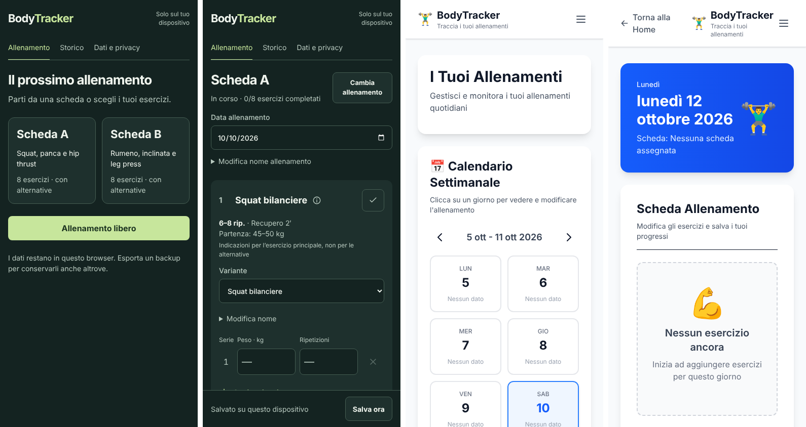

# Restyling BodyTracker: analisi e ricerche

Documento preparatorio. Raccoglie lo stato attuale, il confronto con il PoC in `BodyTracker/`, le ricerche sui concorrenti (Strong, Hevy), i vincoli tecnici del timer di recupero sul web e il metodo Impeccable. La pianificazione è uno step successivo: qui ci sono solo fatti, indicazioni emerse e decisioni aperte.

Obiettivo dichiarato:
- full restyling dell'app Astro nella radice, **mobile first**;
- mantenere calendario, creazione delle schede e personalizzazione degli allenamenti;
- usare [Impeccable](https://github.com/pbakaus/impeccable);
- prendere come riferimento i concorrenti principali (Strong);
- aggiungere un **timer di recupero**: si imposta il recupero (es. 2 minuti), si preme "Inizia" e allo stop compare un conto alla rovescia a tutto schermo.

---

## 1. Stato attuale

### 1.1 App Astro (radice)

**Funzioni presenti**
- Calendario settimanale con navigazione tra le settimane. Un giorno risulta "Completato" se ha esercizi.
- Assegnazione di un **nome di scheda** a ogni giorno della settimana (`bb-calendar`).
- Editor dell'allenamento (esercizio → serie → ripetizioni/peso) in home e nella pagina del giorno (`/workout?date=…`).
- Storico, esportazione/importazione JSON, cancellazione.

**Limiti di prodotto**
- La "scheda" è **solo un'etichetta di testo**: non contiene esercizi, serie target, carichi o recuperi. Non esiste un modello di scheda che si possa avviare.
- Un solo allenamento per data (`bb-workouts` è indicizzato per data).
- Nessun riferimento ai valori della sessione precedente, nessuno stato di serie completata, nessun timer.
- Input tramite `prompt()`, `alert()` e `confirm()` nativi; nessun catalogo esercizi.
- Layout pensato per desktop: griglia a 2 colonne, header con menu ad hamburger, footer da sito vetrina.

**Limiti visivi** (verificati con `npx impeccable detect`)

| Pagina | Problemi |
| --- | --- |
| Home | 8 (7× testo `#99a1af` a contrasto 2,4–2,6:1, 1× card annidate) + 8 avvisi (placeholder 3,4:1) |
| Pagina del giorno | 2 (bianco su verde `#00a63e` a 3,2:1, card annidate) + 1 avviso |
| About (sorgente) | 1 (`border-l-4`, "side-tab") |
| **PoC `BodyTracker/palestra`** | **0** |

Inoltre l'app usa pattern che la [craft floor di Impeccable](https://github.com/pbakaus/impeccable/blob/main/plugin/skills/impeccable/reference/craft-floor.md) rifiuta:
- emoji usate come icone (🏋️‍♂️ 💪 🗑️ 📅 💾);
- header con gradiente blu;
- card ovunque, anche annidate;
- palette Tailwind di default (blu, grigi neutri);
- una palette `brand` viola (`#59168b`) ereditata da un altro progetto.

### 1.2 PoC `BodyTracker/palestra` (HTML/CSS/JS statico)

**Cosa fa meglio** (da portare nell'app Astro)
- **Mondo visivo operativo:** fondo verde scuro, superfici tonali senza ombre, un solo accento verde chiaro per azione, selezione e completamento. Il documento di riferimento è `BodyTracker/documentazione/DESIGN.md`, già scritto con Impeccable.
- **Ergonomia mobile:**
  - pulsanti ≥ 48px, campi serie da 52px, icone SVG a tratto;
  - numeri tabulari;
  - barra fissa in basso con lo stato del salvataggio (`role=status`) e `safe-area-inset-bottom`.
- **Schede vere** (`window.schedeIniziali`): esercizi ordinati con `ordine` (1, 2a, 2b, …: le coppie a/b sono **superserie**), ripetizioni target ("6–8"), carico di partenza, **recupero** ("2′", "60–75″"), unità ("per manubrio") e **varianti alternative**.
- **Catalogo esercizi** con ID stabili e scheda di approfondimento (descrizione, immagine, passaggi, fonti).
- **Riferimento alla sessione precedente**, spunta di esercizio completato, sessione concludibile e riapribile.
- Più allenamenti nella stessa data, con ID univoci.
- **Robustezza dei dati:**
  - formato versionato (`bodytracker.archivio.v1`) e validazione rigida;
  - importazione con unione e deduplicazione;
  - errore di quota gestito e protezione dalla sovrascrittura tra schede.

**Limiti**
- Solo **2 schede fisse** (A/B) definite nel codice: non c'è un'interfaccia per crearle o modificarle.
- Nessun calendario, nessun timer.
- Font di sistema (`system-ui`): la craft floor attuale di Impeccable lo considera un difetto per un mondo visivo proprio ("source and self-host a face").
- JavaScript minificato a mano in un unico file: si riusano le idee e il modello dati, non il codice.

### 1.3 Confronto sintetico

| Capacità | Astro oggi | PoC | Strong / Hevy | Target |
| --- | :-: | :-: | :-: | :-: |
| Calendario settimanale con pianificazione | ✓ (solo nome) | – | – (storico a calendario) | ✓, con scheda vera |
| Creazione e modifica schede | – | – (fisse nel codice) | ✓ (routine, cartelle) | ✓ |
| Varianti/alternative per esercizio | – | ✓ | parziale (sostituisci esercizio) | ✓ |
| Valori precedenti nella riga serie | – | parziale | ✓ | ✓ |
| Spunta della serie | – | per esercizio | ✓ per serie | ✓ per serie |
| Timer di recupero | – | – | ✓ automatico, per esercizio | ✓ a tutto schermo |
| Superserie | – | implicite (2a/2b) | ✓ | ✓ |
| Tipi di serie (riscaldamento, drop, cedimento) | – | – | ✓ | da decidere |
| Catalogo esercizi | – | ✓ (ID stabili) | ✓ (centinaia) | ✓ (catalogo del PoC) |
| Backup locale robusto | base | ✓ | cloud | ✓ (modello PoC) |
| Più allenamenti nello stesso giorno | – | ✓ | ✓ | ✓ |

---

## 2. Concorrenti

Nota sulle fonti: i siti di Strong e Hevy non sono raggiungibili da questo container (policy di rete). I dati vengono dai risultati di ricerca, che citano i loro help center. Molte comparazioni sono pubblicate da app concorrenti: vanno lette con cautela.

### 2.1 Strong (riferimento indicato)

Posizionamento: tracker **minimalista e veloce** per pesi liberi, iOS/Apple Watch, ~4,9★ con oltre 100k recensioni.

**Flusso**
- Si parte da una **routine** (template) o da un allenamento vuoto.
- **Righe serie** a colonne `Serie · Precedente · kg · Ripetizioni · ✓`. I valori della volta scorsa compaiono come suggerimento e si possono riprendere.
- La **spunta di una serie avvia automaticamente il timer di recupero**: [default 2:00](https://help.strongapp.io/article/231-rest-timer), durata diversa **per esercizio** (menu "…"), durata separata per le **serie di riscaldamento**. Il timer compare nella schermata dell'allenamento; su Apple Watch si regola con la Digital Crown.

**Funzioni**
- Tipi di serie: riscaldamento, drop set, cedimento; superserie; note per serie.
- [Calcolatore di riscaldamento](https://help.strongapp.io/article/171-warm-up-calculator); calcolatore 1RM; modifica degli allenamenti passati.

**Critiche ricorrenti:** costo dell'abbonamento, segnalazioni di timer non sempre affidabile, versione gratuita limitata a 3 routine.

### 2.2 Hevy

[Timer di recupero](https://www.hevyapp.com/features/workout-rest-timer/):
- parte quando si spunta la serie; durata da 5s a 5 min, **per esercizio**, scelta sotto il nome dell'esercizio;
- durata di default nelle impostazioni (non retroattiva sulle routine esistenti);
- **±15 s** durante il conteggio, **salta**; disattivabile per gli esercizi in superserie o circuito;
- suoni configurabili (fine timer, spunta serie, record personale);
- countdown nella [Live Activity / widget](https://www.hevyapp.com/features/live-activity/), con ±15 s e salta.

Logging:
- [nuovi esercizi precompilati](https://help.hevyapp.com/hc/en-us/articles/35361530647959) con serie, peso e ripetizioni dell'ultima volta;
- swipe a sinistra per eliminare una serie.

Comparazioni: Hevy è ritenuto più "social" e con app web; Strong più essenziale e con più tipi di serie ([SensAI](https://www.sensai.fit/blog/hevy-vs-strong-2026), [Setgraph](https://setgraph.app/articles/hevy-vs-strong-app-comparison-2026), [Lyfta](https://www.lyfta.app/vs/hevy-vs-strong)).

### 2.3 Pattern condivisi da adottare

1. **Avvio in un tocco** dalla scheda del giorno: il calendario dice cosa fare oggi.
2. **Riga serie come unità di lavoro**:
   - valori precedenti visibili sulla riga;
   - precompilazione o tocco per copiarli;
   - spunta grande a destra, raggiungibile con il pollice.
3. **Spunta = fine serie = parte il recupero**, con durata per esercizio ereditata dalla scheda.
4. **Timer sempre visibile e regolabile:** ±15 s, salta, segnale acustico a fine conteggio.
5. **Allenamento attivo persistente:** se si naviga altrove resta una mini-barra che riporta alla sessione (pattern di entrambe le app).
6. **Fine allenamento con riepilogo** (durata, volume, serie) e salvataggio nello storico.
7. **Template modificabili** separati dalle istanze: modificare una sessione non riscrive la scheda, a meno di una scelta esplicita.

Fonti aggiuntive: [Strong su App Store](https://apps.apple.com/us/app/strong-workout-tracker-gym-log/id464254577), [confronto app con timer di recupero](https://saylift.app/best/workout-app-with-rest-timer), [Iron-Log, clone open source del flusso di Strong](https://github.com/shikhashah92/Iron-Log/pull/3).

---

## 3. Timer di recupero: requisiti e vincoli del web

### 3.1 Interpretazione della richiesta

"Scrivi recupero 2 minuti, clicchi inizia e allo stop esce il timer tutto schermo col conto alla rovescia". Il flusso proposto:

1. Ogni esercizio ha un campo **Recupero**, precompilato dalla scheda e modificabile in sessione.
2. **Inizia serie** avvia, facoltativamente, un cronometro della serie in corso.
3. **Stop**, che coincide con la spunta della serie, registra la serie e apre l'**overlay a tutto schermo** con il conto alla rovescia. Contiene −15 s, +15 s, Salta e la serie successiva (esercizio, carico e ripetizioni attesi).
4. A fine conteggio: segnale acustico e visivo, vibrazione dove disponibile; l'overlay passa allo stato "Vai" e si chiude.

Da decidere in pianificazione: se "Inizia" è necessario o se basta la spunta, come in Strong e Hevy.

### 3.2 Vincoli tecnici verificati

| Tema | Fatto | Conseguenza |
| --- | --- | --- |
| Timer in background | I browser rallentano `setTimeout`/`setInterval` nelle schede in background (≥1 s, a volte di più) e `requestAnimationFrame` si ferma ([1](https://hackernoon.com/the-hidden-bug-breaking-most-javascript-timers?source=rss), [2](https://dev.to/ufebri/build-a-zero-drift-web-timer-3bip)) | Salvare **l'istante di fine** (`endsAt`), calcolare il tempo restante come `endsAt − Date.now()` e persistere il timer in localStorage, così sopravvive a ricarica o ritorno sull'app |
| Notifiche locali programmate | Non esistono nello standard Notifications. Su iOS il codice non gira con l'app chiusa o lo schermo spento; l'unica via è un Web Push da server, con PWA installata ([Apple forum](https://developer.apple.com/forums/thread/735402), [Pushpad](https://pushpad.xyz/blog/ios-special-requirements-for-web-push-notifications)) | Senza backend, **l'avviso a fine recupero è garantito solo con l'app in primo piano**. È un vincolo di prodotto da accettare o da risolvere con un backend per il push (oggi escluso) |
| Schermo acceso | Screen Wake Lock supportato da Safari iOS 16.4+. Nelle web app installate sulla Home un bug era aperto: risolto in iOS 18.4 secondo [Progressier](https://progressier.com/pwa-capabilities/screen-wake-lock), mentre i dati MDN restano in conflitto ([WebKit 254545](https://bugs.webkit.org/show_bug.cgi?id=254545)) | Richiedere il **wake lock durante l'allenamento attivo** e riacquisirlo a `visibilitychange`. Da verificare su un dispositivo reale |
| Vibrazione | `navigator.vibrate` non è disponibile su iOS Safari; funziona su Android ([1](https://bugnet.io/blog/fix-web-game-vibrate-api-not-available-ios-safari), [2](https://www.mintlify.com/lochie/web-haptics/advanced/browser-support)) | Vibrazione solo come miglioramento progressivo; su iOS il segnale principale è suono più schermo |
| Suono | L'audio in Safari richiede un gesto dell'utente. Pratica nota, non confermata dalle ricerche: sbloccare un `AudioContext` al tocco di "Inizia" o della spunta | Da verificare su iPhone e Android. Prevedere un'opzione "suono sì/no" |
| Tutto schermo | Su iPhone l'API Fullscreen per elementi non video non è affidabile (da verificare) | Usare un **overlay** `position: fixed` a pieno viewport (`100dvh`, safe area), non `requestFullscreen` |
| Accessibilità | Uno screen reader non deve annunciare ogni secondo | `aria-live` solo a soglie (es. 30 s, 10 s, fine), cifre tabulari grandi, nessuna animazione con `prefers-reduced-motion`, focus intrappolato nell'overlay e restituito alla chiusura |

**Conclusione:** il timer è fattibile lato client con un'esperienza da app nativa **finché l'app è aperta**, in linea con il vincolo "nessun backend". Per avvisi a schermo spento o con l'app chiusa servirebbe Web Push con un server: è una decisione di prodotto, non un dettaglio tecnico.

### 3.3 PWA

Per l'uso in palestra conviene rendere l'app installabile: manifest, icona, `display: standalone`, e un service worker per la riapertura offline (il PoC non lo include e lo segnala come limite). Su iOS l'installazione è anche il prerequisito per qualsiasi futuro Web Push.

---

## 4. Impeccable: come applicarlo a questo progetto

**Che cos'è:** una skill di design per agenti di codice, con 24 comandi, un detector deterministico di anti-pattern (59 regole) e hook che lo eseguono dopo ogni modifica alla UI. Versione analizzata: 4.5.2, commit `d631a88` dell'8 ottobre 2026.

**Installazione**
- `npx impeccable install` nella radice, oppure il plugin Claude Code (`/plugin marketplace add pbakaus/impeccable`).
- Poi `/impeccable init`.

**Artefatti da versionare:** `PRODUCT.md` e `DESIGN.md` nella radice, poi `.impeccable/design.json`, `.impeccable/config.json`, `.impeccable/surfaces/*.md` e `.impeccable/critique/*.md`.

**Comandi utili per questo restyling**
- `init`: contesto di prodotto. Il PoC ha già un `PRODUCT.md`, da aggiornare: oggi parla di "schede A/B iniziali" e di stack statico.
- `shape`: brief UX per superficie (allenamento attivo, calendario, editor schede, timer), con domande di scoperta prima del codice.
- Nuovo lavoro e scelta del mondo visivo, poi `document` ed `extract` per scrivere `DESIGN.md` e i token.
- `critique` e `audit` come verifica (accessibilità, prestazioni, responsive); `harden` per stati vuoti, errori, overflow e i18n; `polish` finale.

**Modalità:** tutte le superfici dell'app sono **Operate**: chiarezza, controlli standard e scena d'uso reale contano più dell'espressività. Il mondo visivo contribuisce solo con tipografia, palette, densità e **una mossa distintiva**. Candidato naturale per la mossa distintiva: il **timer di recupero a tutto schermo**.

**Regole che impattano direttamente il restyling** (craft floor)
- **Icone:** niente emoji; un set SVG coerente (libreria o disegnate), un solo tratto.
- **Contenitori:** niente card annidate né card come struttura di pagina; niente header a gradiente, testo sfumato o bordi laterali spessi.
- **Testo:** niente etichetta sopra il titolo; contrasto ≥ 4,5:1 anche per placeholder e testo secondario, con neutri tinti (mai grigio puro).
- **Font:** self-hosted, scelto per il carattere del mondo visivo. Il font di sistema del PoC andrebbe sostituito o difeso esplicitamente nel brief.
- **Tema chiaro o scuro:** scelto dalla scena d'uso (palestra, luce variabile, telefono in mano tra una serie e l'altra), non dalla categoria.
- **Superfici del browser:** selezione, caret, scrollbar, focus e cifre tabulari vanno tematizzati dalla palette.
- **Modali:** solo dove serve un focus protetto. Il timer lo giustifica; la creazione di un esercizio probabilmente no.
- **Movimento:** un solo momento progettato, ease-out esponenziale.

**Redesign o rifinitura:** Impeccable distingue tra "refinement preserves" e "redesign replaces". Il PoC è già un mondo coerente e approvato dall'utente. La scelta naturale è **adottarlo ed estenderlo** (rifinitura del mondo del PoC, redesign dell'app Astro), senza mescolare due identità.

**Tailwind 4:** i token del `DESIGN.md` vanno tradotti in un blocco `@theme` in `global.css`, che sostituirà `tailwind.config.mjs` e la palette viola attuale. Il detector si può eseguire in CI o in locale con `npx impeccable detect src/`. Per gli URL serve Chromium: in questo container funziona con un wrapper `--no-sandbox`.

---

## 5. Indicazioni emerse per la UX mobile (non ancora un piano)

**Navigazione**
- Tab bar in basso, a portata di pollice: **Oggi**, **Calendario**, **Schede**, **Storico**, con **Dati** nelle impostazioni.
- Via header ad hamburger e footer da sito.

**Oggi**
- La scheda pianificata per la data con un grande "Inizia allenamento".
- Alternative: un'altra scheda o un allenamento libero.
- Se c'è un allenamento in corso, "Riprendi".

**Allenamento attivo**
- Una colonna. Per ogni esercizio: nome (apre l'approfondimento), variante, target dalla scheda (ripetizioni, carico di partenza, recupero) e righe serie `n · precedente · kg · rip · ✓`.
- Barra fissa in basso con durata della sessione, stato del salvataggio e "Termina".
- Mini-barra persistente quando si esce dalla schermata.

**Timer**
- Overlay a tutto schermo con cifre molto grandi e progresso.
- Controlli −15 s, +15 s, Salta; anteprima della serie successiva.

**Schede**
- Elenco ed editor: esercizi dal catalogo, ordine e superserie, serie e ripetizioni target, carico di partenza, recupero in secondi, alternative.
- Duplica e archivia; le schede A/B del PoC diventano dati iniziali.

**Calendario**
- Settimana scorrevole: ogni giorno mostra la scheda pianificata e lo stato (fatto, saltato, programmato).
- Toccando un giorno passato si apre lo storico di quel giorno; toccando un giorno futuro si cambia la pianificazione.
- La pianificazione assegna una **scheda**, non un testo libero.

**Storico:** sessioni per data, dettaglio con le serie, eventuali progressi per esercizio (carico massimo, volume).

**Modello dati**
- Unificare sul formato versionato del PoC: `versione`, allenamenti con `id`, più sessioni nello stesso giorno, `concluso`.
- Aggiungere `schede` (template), `calendario` (giorno della settimana → id scheda) e recupero in **secondi numerici**. Il PoC usa testi come "60–75″": serve una conversione.
- Migrare `bb-workouts`, `bb-calendar` e l'archivio `bodytracker.archivio.v1`.

---

## 6. Decisioni aperte per la pianificazione

1. **Mondo visivo:** adottare ed estendere quello del PoC (verde scuro), o farne uno nuovo con il processo di new-work di Impeccable? Tema solo scuro, o scuro più chiaro?
2. **Font:** sostituire `system-ui` con un font self-hosted, come chiede Impeccable, o mantenerlo come scelta esplicita?
3. **Semantica del timer:** "Inizia" più "Stop" (cronometro della serie, poi recupero) o spunta della serie con avvio automatico del recupero, come in Strong e Hevy? Avvio automatico disattivabile per le superserie?
4. **Avvisi a schermo spento:** accettare il limite "solo app aperta più wake lock" o prevedere in futuro un backend per il Web Push?
5. **Ambito delle funzioni:** tipi di serie (riscaldamento, drop, cedimento), superserie esplicite, grafici di progresso, calcolatore 1RM o dischi: cosa entra nella prima versione?
6. **PWA:** installabile con service worker offline, sì o no?
7. **Dati esistenti:** migrare `bb-workouts` e l'archivio del PoC, e con quale priorità? Il PoC resta pubblicato o viene sostituito?
8. **Unità:** solo kg, o anche lb?
9. **Hosting:** il sito è statico; dove viene pubblicato (dominio `francescoperagine.com`, sottocartella)? Influisce su `base` di Astro e sullo scope del service worker.

---

## Fonti

- Impeccable: [repository](https://github.com/pbakaus/impeccable), [craft floor](https://github.com/pbakaus/impeccable/blob/main/plugin/skills/impeccable/reference/craft-floor.md), [modalità Operate](https://github.com/pbakaus/impeccable/blob/main/plugin/skills/impeccable/reference/mode-operate.md), [shape](https://github.com/pbakaus/impeccable/blob/main/plugin/skills/impeccable/reference/shape.md)
- Strong: [Rest Timer](https://help.strongapp.io/article/231-rest-timer), [primo allenamento](https://help.strongapp.io/article/229-my-first-workout), [Warm-up Calculator](https://help.strongapp.io/article/171-warm-up-calculator), [Apple Watch](https://help.strongapp.io/article/224-workout-on-apple-watch), [App Store](https://apps.apple.com/us/app/strong-workout-tracker-gym-log/id464254577), [recensione RepReturn](https://repreturn.com/strong-app-review/)
- Hevy: [rest timer](https://www.hevyapp.com/features/workout-rest-timer/), [Live Activity](https://www.hevyapp.com/features/live-activity/), [logging](https://help.hevyapp.com/hc/en-us/articles/35361530647959), [impostazioni](https://www.hevyapp.com/features/workout-settings/)
- Comparazioni: [SensAI](https://www.sensai.fit/blog/hevy-vs-strong-2026), [Setgraph](https://setgraph.app/articles/hevy-vs-strong-app-comparison-2026), [Lyfta](https://www.lyfta.app/vs/hevy-vs-strong), [SayLift](https://saylift.app/best/workout-app-with-rest-timer), [Iron-Log](https://github.com/shikhashah92/Iron-Log/pull/3)
- Piattaforma web: [Apple Developer Forums, notifiche PWA](https://developer.apple.com/forums/thread/735402), [Pushpad, Web Push iOS](https://pushpad.xyz/blog/ios-special-requirements-for-web-push-notifications), [Progressier, Wake Lock](https://progressier.com/pwa-capabilities/screen-wake-lock), [WebKit 254545](https://bugs.webkit.org/show_bug.cgi?id=254545), [Chrome, Wake Lock](https://developer.chrome.com/docs/capabilities/web-apis/wake-lock), [vibrazione su iOS](https://bugnet.io/blog/fix-web-game-vibrate-api-not-available-ios-safari), [timer in background](https://hackernoon.com/the-hidden-bug-breaking-most-javascript-timers?source=rss), [timer senza deriva](https://dev.to/ufebri/build-a-zero-drift-web-timer-3bip)
